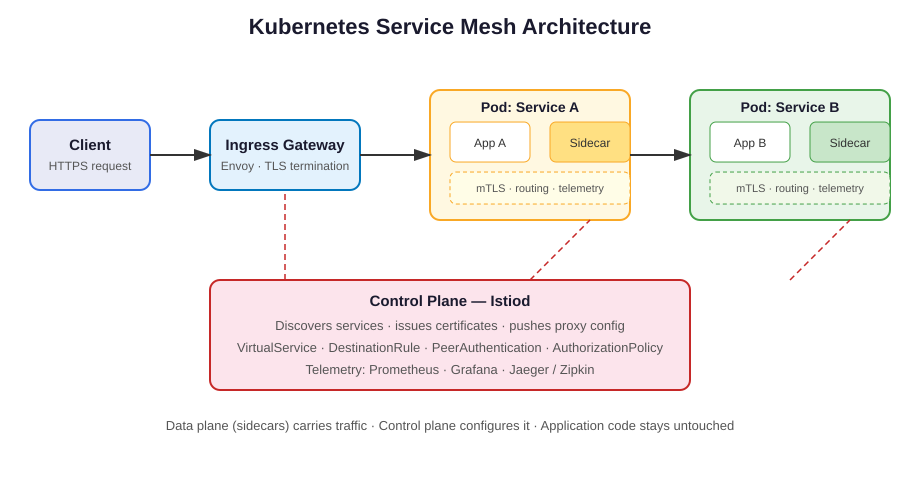

# Kubernetes Service Mesh Guide


> A practical guide to running a service mesh on Kubernetes: traffic management, zero-trust mTLS, observability, and progressive delivery — without rewriting your applications.

## TL;DR

A service mesh moves networking concerns **out of your code** and into a dedicated infrastructure layer. A lightweight sidecar proxy sits next to every pod and handles routing, retries, encryption, and telemetry — so your services just talk HTTP and the mesh handles the rest.

**When you need one:** 20+ services, strict security requirements, canary/blue-green releases, or multi-team ownership of one cluster.
**When you don't:** a handful of services, a single team, or latency budgets tighter than ~1–3 ms per hop.

## Architecture



```
Client → Ingress Gateway → [Sidecar Proxy] → Service A → [Sidecar Proxy] → Service B
                                ↕ control plane (Istiod)
                         mTLS · routing rules · telemetry · policy
```

The **data plane** (Envoy sidecars) carries every request. The **control plane** (Istiod) configures those proxies. Your application code never sees either.

## How It Works, Step by Step

### 1. Traffic management
`VirtualService` and `DestinationRule` (see `istio-traffic.yaml`) define *where* traffic goes and *how*: weighted splits for canaries, header-based routing for testing, timeouts, and retries with budgets.

### 2. Zero-trust security
`PeerAuthentication` in `STRICT` mode means every pod-to-pod call is mutually authenticated and encrypted with mTLS — no plaintext inside the cluster, no implicit trust between namespaces. `AuthorizationPolicy` then decides *who* may call *what*, down to the HTTP method and path.

### 3. Observability for free
Every sidecar emits the same metrics, logs, and traces: request rate, error rate, latency (the RED method), and distributed traces. One dashboard pattern works for every service, no per-team instrumentation.

### 4. Resilience
Circuit breaking (outlier detection), connection-pool limits, and retry budgets stop one failing service from cascading across the mesh.

## Service Mesh Comparison

| Feature | Istio | Linkerd | Cilium Service Mesh |
|---|---|---|---|
| Proxy | Envoy | linkerd2-proxy (Rust) | Envoy (eBPF data plane) |
| mTLS by default | Opt-in (STRICT mode) | Yes, always | Yes |
| Traffic splitting | Rich (weight, header, mirror) | Weight-based | Rich |
| Learning curve | Steepest | Gentlest | Moderate |
| Best for | Full-featured, multi-cluster | Simplicity, small teams | eBPF + network policy fans |
| Overhead per hop | ~1–3 ms | < 1 ms | ~1 ms |

## Cost & Performance Notes

- **Sidecar tax:** each proxy uses roughly 0.1–0.5 vCPU and 50–150 MB RAM at idle — budget it in your node sizing (see the EKS autoscaling companion pattern).
- **Ambient mesh** (Istio's sidecarless mode) removes per-pod proxies and cuts that tax, at the cost of a newer, still-maturing feature set.
- **Latency:** measure p99, not p50 — mesh overhead shows up in the tail.

## Common Pitfalls

1. **mTLS in PERMISSIVE mode forever** — you think you're encrypted, but plaintext still works. Move to STRICT per namespace, then cluster-wide.
2. **Retries without budgets** — a retry storm can amplify an outage 3×. Cap retries and add per-try timeouts.
3. **Mesh first, problems later** — adopting a mesh to "fix microservices" without a concrete pain (security, releases, observability) just adds a layer to debug.
4. **Forgetting the gateway** — north-south traffic (ingress) needs its own Gateway configuration; sidecars only cover east-west.

## Try It

```bash
# Install Istio (demo profile is for learning only — never production)
istioctl install --set profile=demo -y
kubectl label namespace default istio-injection=enabled

# Apply the traffic, security, and gateway manifests in this repo
kubectl apply -f istio-traffic.yaml
```

## Quiz Teaser

Can you tell a `VirtualService` from a `DestinationRule` — and explain why mTLS alone doesn't authorize anything? Take the 5-question quiz in [`quiz.md`](quiz.md).

## Further Reading

- Istio documentation: traffic management, security, and ambient mesh
- "The Service Mesh: What Every Software Engineer Needs to Know" (O'Reilly)
- Companion guides in this series: Kubernetes Security, EKS Autoscaling, AWS VPC Networking
